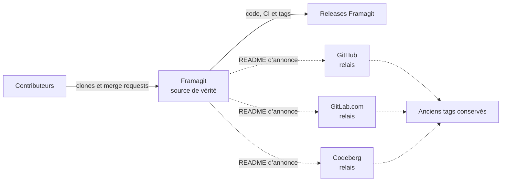

# ⚓ Désarrimage a changé de cap

**Le projet est développé sur Framagit. Ce dépôt est un relais d’annonce, pas une seconde source de code.**

## 🧭 Source de vérité

**https://framagit.org/SuperT0f/desarrimage**

```bash
git clone git@framagit.org:SuperT0f/desarrimage.git
```



## 📣 Dernière release — 0.10.0

**La météo des données est arrivée.** La vitrine distingue désormais les informations relues, celles à revoir et celles sans date. Les preuves `documented`, `tested` et `verified` ne se confondent plus, et le miroir de secours s’affiche clairement quand l’API fait une sieste.

- 🏷️ [Release 0.10.0 sur Framagit](https://framagit.org/SuperT0f/desarrimage/-/releases/v0.10.0)
- 📣 [Annonce](https://framagit.org/SuperT0f/desarrimage/-/blob/main/docs/releases/0.10.0-marketing.md)
- ⚙️ [Note technique](https://framagit.org/SuperT0f/desarrimage/-/blob/main/docs/releases/0.10.0-tech.md)
- 🧭 [Voir la fraîcheur du catalogue](https://desarrimage.prigent.tech/fraicheur)

## 🗃️ Résumé des releases

| Version | Cap de la release | Liens |
| --- | --- | --- |
| **0.10.0** | Fraîcheur des données, preuves clarifiées, contributions guidées et 29 tests | [Release](https://framagit.org/SuperT0f/desarrimage/-/releases/v0.10.0) · [Note](https://framagit.org/SuperT0f/desarrimage/-/blob/main/docs/releases/0.10.0-marketing.md) |
| **0.9.0** | Vite 8, premiers tests Vitest, Oxlint et couverture CI | [Release](https://framagit.org/SuperT0f/desarrimage/-/releases/v0.9.0) · [Note](https://framagit.org/SuperT0f/desarrimage/-/blob/main/docs/releases/0.9.0-marketing.md) |
| **0.8.0** | Inventaire public, preuves de migration, backlog et KPI | [Release](https://framagit.org/SuperT0f/desarrimage/-/releases/v0.8.0) · [Note](https://framagit.org/SuperT0f/desarrimage/-/blob/main/docs/releases/0.8.0-marketing.md) |
| **0.7.0** | Migration réelle vers Framagit et forges secondaires en relais | [Release](https://framagit.org/SuperT0f/desarrimage/-/releases/v0.7.0) · [Preuve](https://desarrimage.prigent.tech/produit/github) |

[Consulter toutes les releases Framagit](https://framagit.org/SuperT0f/desarrimage/-/releases) · [Changelog complet](https://framagit.org/SuperT0f/desarrimage/-/blob/main/CHANGELOG.md)

## Ce dépôt est un relais

La branche `main` ne contient plus les sources : uniquement ce README. **Les nouvelles contributions, releases et merge requests se passent sur Framagit.**

Les anciens tags et l’historique Git sont conservés à titre d’archive. Ils permettent de consulter ou restaurer le code antérieur, mais ne représentent plus la version active du projet.

Merci de ne pas ouvrir de contribution ici : [**rejoindre Désarrimage sur Framagit**](https://framagit.org/SuperT0f/desarrimage).
