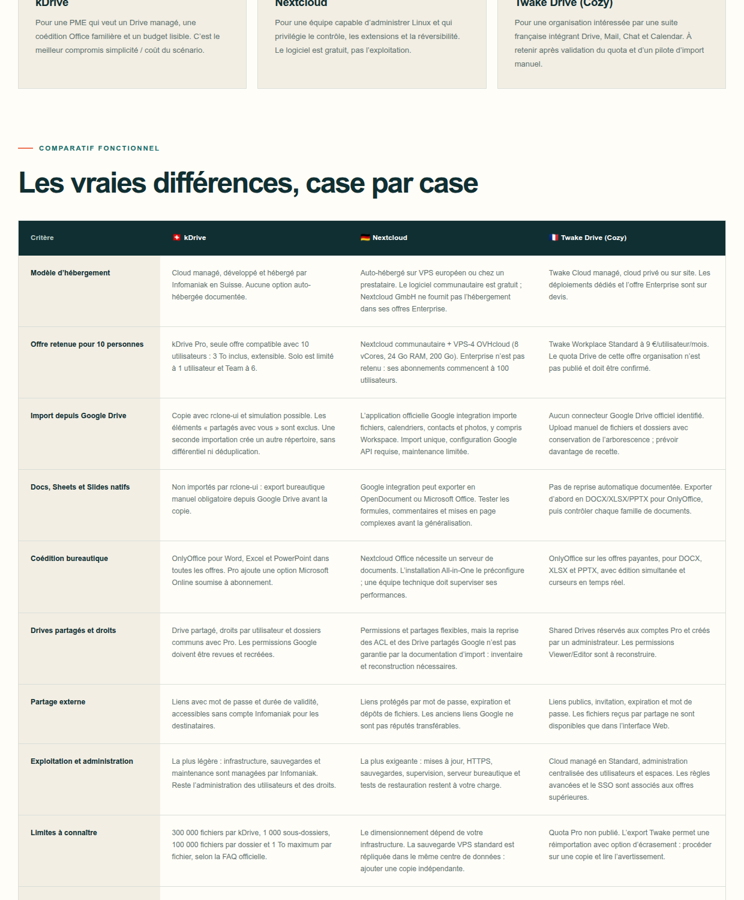
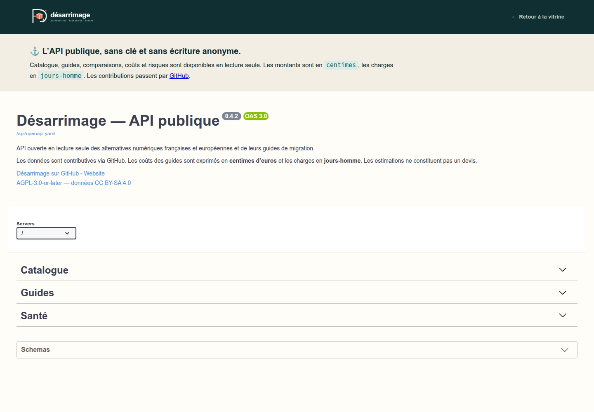
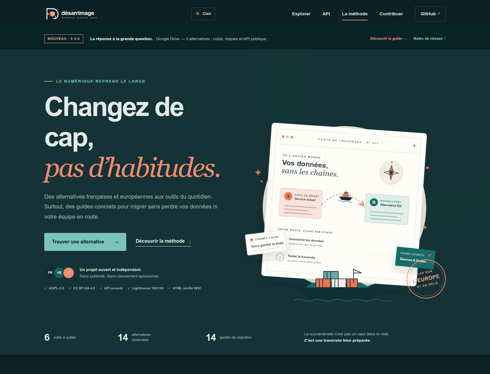

<div align="center">
  

  <h1>⚓ Désarrimage</h1>

  <p><strong>Changer de cap, pas d’habitudes.</strong></p>
  <p>Des alternatives françaises et européennes… et surtout le plan de vol pour y aller sans perdre vos données en mer.</p>

  <p>
    <a href="https://desarrimage.prigent.tech">
      
    </a>
    <a href="https://github.com/superT0f/desarrimage/actions/workflows/ci.yml">
      
    </a>
    <a href="CHANGELOG.md">
      
    </a>
    <a href="LICENSE">
      
    </a>
    <a href="data/LICENSE">
      
    </a>
  </p>
  <p>
    
    
    
    
    
    <a href="AGENTS.md">
      
    </a>
  </p>
</div>

---

## 🧭 Pourquoi ce projet ?

Les annuaires répondent à **« par quoi remplacer cet outil ? »**.

Désarrimage s’attaque à la question suivante, celle qui fait généralement remettre la migration à plus tard :

> **« Très bien… mais je fais comment, concrètement ? »**

Chaque fiche propose :

- 🌍 des alternatives françaises et européennes, avec leur pays, leur licence et leur modèle économique ;
- ⚖️ les avantages **et** les inconvénients, sans enjolivement commercial ;
- 🗺️ un mode opératoire ordonné : inventaire, export, test, bascule et retour arrière ;
- ⏱️ une estimation du temps et de la difficulté ;
- 🔗 des sources officielles pour vérifier les informations.

Le projet est indépendant, sans publicité et sans classement sponsorisé. Moins de dépendance, plus de documentation. ⚓

## ✨ Dans la besace

- **20 produits** documentés ;
- **14 alternatives** françaises ou européennes ;
- **14 migrations** détaillées, soit **56 étapes** actionnables ;
- Gmail, Slack, Google Drive, Notion, Trello et Zoom parmi les premiers outils à quitter ;
- un guide complet avec **10 critères, 3 budgets et 7 risques** ;
- une API publique en lecture seule et son Swagger auto-hébergé ;
- une home qui reste utilisable grâce à un instantané du catalogue si l’API fait une sieste.

## 📦 Nouveau en 0.6.0 — Migration Share Pack

Les guides ne restent plus seulement sur le site : chacun peut exporter un **Share Pack** avec ses sources et hypothèses.

- **JSON** fidèle à l’API publique ;
- **carte PNG 1200×630** générée dans le navigateur ;
- **document A4** à imprimer ou enregistrer en PDF ;
- **pré-rendu statique** avec OpenGraph, canonical et JSON-LD ;
- niveaux de preuve `draft`, `documented`, `tested`, `verified`.

Quatre guides complets sont disponibles : **Google Drive, Slack, Gmail et Notion**. Ils couvrent 3 hébergements, coûts natifs convertis en euros, limites d’import et risques de reconstruction.

Le miroir statique `client/public/mirror/api/` permet de builder et pré-rendre sans MySQL ni réseau :

```bash
make mirror   # Met à jour le miroir depuis l’API
make build    # Construit le front et pré-rend les guides
make audit    # Vérifie les deux thèmes avec Lighthouse
```

La gouvernance des preuves et des contributions est détaillée dans [`docs/gouvernance.md`](docs/gouvernance.md) et l’[ADR 0001](docs/adr/0001-guides-normalises.md).

## 🚀 Nouveau en 0.4.2 — la réponse à la grande question

La 0.4.2 apporte le premier guide comparatif complet **Google Drive → Nextcloud, kDrive et Twake Drive**, les coûts calculés, le registre des risques et une documentation OpenAPI publique. Parce que **42 est la réponse**, mais qu’un bon plan de migration reste quand même recommandé. ⚓

- 📣 [Lire la note marketing](docs/releases/0.4.2-marketing.md)
- ⚙️ [Lire la note technique](docs/releases/0.4.2-tech.md)
- 🗺️ [Explorer le guide en production](https://desarrimage.prigent.tech/produit/google-drive)
- 🔌 [Ouvrir le Swagger](https://desarrimage.prigent.tech/swagger.html)

<p>
  
  
</p>

## 🐳 Démarrer avec Docker — la voie royale

Prérequis : **Docker avec Compose v2**, ou **Podman**. Aucun PHP, Node.js ou MySQL à installer sur ta machine.

```bash
git clone git@github.com:superT0f/desarrimage.git
cd desarrimage
make dev
```

Au premier lancement, les images sont téléchargées et construites. Ensuite :

1. MariaDB démarre avec un volume persistant ;
2. l’API attend la base, applique les migrations Phinx et importe le catalogue ;
3. Vite démarre avec le hot-reload et transmet `/api` à PHP.

Une fois les conteneurs prêts :

| Service | Adresse |
| --- | --- |
| 🖥️ Application | http://localhost:5173 |
| ⚙️ API — santé | http://localhost:8080/api/health |
| 🗺️ Exemple de fiche | http://localhost:5173/produit/google-drive |
| 🗄️ MariaDB | `127.0.0.1:3307` |

Les identifiants de développement sont `desarrimage` / `desarrimage-dev`. Ils sont jetables, locaux et **ne doivent jamais servir en production**.

> [!TIP]
> `Ctrl+C` arrête la stack. Les sources restent montées dans les conteneurs : modifie un fichier, recharge, c’est tout. Le fameux « ça marche sur ma machine » est cordialement invité à prendre le large.

### 🦭 Podman, tu es le bienvenu

Le `Makefile` détecte automatiquement **Docker Compose**, `podman-compose` ou `podman compose`.

> [!NOTE]
> **Environnement réellement testé le 16 novembre 2026 : Podman 4.9.3 + podman-compose 1.6.0.** Build des images Node 22, PHP 8.4 et MariaDB 10.11, migrations, seed, Swagger et appels API vérifiés. Les autres versions restent compatibles en principe, mais pas encore validées une par une.

Si Podman est présent sans provider Compose :

```bash
make compose-bootstrap
make dev
```

`compose-bootstrap` installe `podman-compose` dans `.tmp/`, ignoré par Git. Rien n’est installé globalement et aucun `sudo` n’est nécessaire. Tu peux aussi forcer le moteur :

```bash
make dev COMPOSE="docker compose"
# ou
make dev COMPOSE="podman compose"
```

### ⚓ Commandes de bord

| Commande | Effet |
| --- | --- |
| `make dev` | Construit et démarre toute la stack au premier plan |
| `make dev-detached` | Démarre la stack en arrière-plan |
| `make dev-ps` | Affiche les conteneurs et leur état |
| `make dev-logs` | Suit les logs front, API et base |
| `make dev-down` | Arrête les conteneurs en conservant les volumes |
| `make docker-check` | Valide la configuration Compose |
| `make check` | Lint PHP, validation Composer/JSON et build Vite |

## 🌓 Thème et accessibilité — mesurés, pas promis

La vitrine propose un **thème clair/sombre persistant**, initialisé selon la préférence système et modifiable dans le header. Les onglets de migration sont navigables au clavier, les contrastes ont été corrigés et les états de chargement/erreur sont annoncés aux technologies d’assistance.

Audit réel du 16 novembre 2026 avec **Lighthouse 13.6.0**, sur chaque thème :

- **Accessibilité : 100/100** ;
- **Bonnes pratiques : 100/100** ;
- **SEO : 100/100** ;
- **Performance en production : 99/100** ;
- **Exploration agentique : 100/100**.

Le validateur HTML du W3C ne remonte aucune erreur en production. `robots.txt`, `sitemap.xml` et `llms.txt` sont servis par la vitrine pour faciliter l’exploration par les moteurs et agents.

Pour reproduire l’audit après avoir lancé la stack :

```bash
make dev-detached
make audit
```

La CI exécute également Lighthouse sur les deux thèmes et échoue si l’un de ces trois scores repasse sous 100.



## 🧱 Stack et architecture

```text
desarrimage/
├── 🐳 Dockerfile                 # Targets `api` et `client`
├── 🐳 compose.yaml               # Vue + PHP/Apache + MariaDB
├── ⚙️ api/
│   ├── public/                   # Front controller Slim 4
│   ├── src/                      # PDO, configuration et repository
│   ├── db/migrations/            # Schéma versionné avec Phinx
│   └── scripts/                  # Seed, instantané et entrypoint Docker
├── 🖥️ client/
│   ├── public/                   # SVG et instantané du catalogue
│   └── src/                      # Vue 3, Pinia, Router, Axios et Vite
├── 🗺️ data/catalog.json          # Produits et migrations contributifs
├── 📊 data/guides/               # Comparatifs, coûts, risques et sources
└── 🚀 Makefile                   # Dev, qualité et déploiement Gandi
```

- **Back** : PHP 8.4, Slim 4, PDO, Phinx, MariaDB/MySQL ;
- **Front** : Vue 3, Vite 5, Pinia, Vue Router, Axios ;
- **Infra** : Docker Compose pour le développement, Apache + MySQL chez Gandi pour la production ;
- **Données** : JSON lisible et versionné, importé en base avec un seed idempotent ;
- **Guides riches** : scénario, critères et cellules de comparaison, coûts calculés, risques, chronologie et sources stockés dans des tables normalisées. Chaque élément reste contributif séparément dans `data/guides/`.

## 🛠️ Développement sans Docker

Tu préfères naviguer à la rame ? Il faut PHP 8.2+, Composer, Node.js 20+ et MySQL/MariaDB.

```bash
make install
# Crée la base et renseigne api/.env, puis :
make db-migrate
make db-seed
make dev-api
```

Dans un second terminal :

```bash
make dev-client
```

Le front répond sur `http://localhost:5173` et l’API sur `http://localhost:8080`.

## 🔌 API publique

| Route | Description |
| --- | --- |
| `GET /api/health` | Vérifie l’API et sa connexion à la base |
| `GET /api/openapi.yaml` | Télécharge la spécification OpenAPI publique |
| `GET /api/stats` | Compte les produits, alternatives et migrations |
| `GET /api/categories` | Liste les catégories |
| `GET /api/products` | Liste et filtre les produits |
| `GET /api/products/{slug}` | Retourne une fiche et ses modes opératoires |
| `GET /api/guides` | Liste les guides comparatifs publiés |
| `GET /api/guides/{slug}` | Retourne un guide complet et ses coûts calculés |
| `GET /api/guides/{slug}/comparison` | Retourne uniquement le comparatif normalisé |
| `GET /api/guides/{slug}/costs` | Retourne les hypothèses et coûts par destination |
| `GET /api/guides/{slug}/risks` | Retourne le registre des risques |

Exemple complet : [Google Drive vers trois alternatives](https://desarrimage.prigent.tech/produit/google-drive), avec API sur [`/api/guides/quitter-google-drive`](https://desarrimage.prigent.tech/api/guides/quitter-google-drive).

La documentation interactive est disponible sur [`/swagger.html`](https://desarrimage.prigent.tech/swagger.html). Swagger UI et ses assets sont auto-hébergés ; aucun CDN n’est utilisé. `node scripts/sync-api-docs.mjs` copie la spécification et Swagger UI avant les commandes `dev` et `build`.

Filtres disponibles : `search`, `category` et `region` (`fr`, `europe`, `other`).

```bash
curl 'http://localhost:8080/api/products?region=fr'
curl 'http://localhost:8080/api/products?search=nextcloud'
curl 'http://localhost:8080/api/products/google-drive'
```

## 🚀 Déploiement Gandi

Le vhost attendu est `/mnt/gandi/vhosts/desarrimage.prigent.tech/htdocs`.

```bash
make deploy       # Front uniquement
make push         # API + données + front
make deploy-dry   # Simulation sans écrire sur le vhost
make status       # Différences avec la production
make verify       # Home et assets publics
make verify-api   # Sonde MySQL de production
```

Pour initialiser la production, copie `htdocs/api/.env.example` en `htdocs/api/.env`, renseigne les variables `DESARRIMAGE_DB_*`, puis exécute les migrations et le seed **sur le serveur Gandi**. Les déploiements préservent toujours le `.env` et le répertoire `data/`.

## 🏷️ Versions et changelog

Le projet utilise **[Semantic Versioning](https://semver.org/lang/fr/)** : `MAJEUR.MINEUR.CORRECTIF`. Pendant la phase `0.x`, l’API et le modèle de données peuvent encore bouger ; les versions `1.x` seront stabilisées.

La référence est le fichier `.version`, synchronisé avec `client/package.json` et `client/package-lock.json`. La version est injectée dans le build Vite et affichée dans le footer.

```bash
make version                    # Affiche la version actuelle
make changelog                  # Régénère CHANGELOG.md depuis les commits
make release VERSION=0.2.0      # Synchronise la version + changelog
```

Le [CHANGELOG.md](CHANGELOG.md) est généré automatiquement à partir des **Conventional Commits** : `feat`, `fix`, `docs`, `ci`, `chore`, etc. Chaque entrée pointe vers son commit et chaque version vers son tag GitHub.

Chaque release dispose aussi de deux récits dans `docs/releases/` : une note technique et une note marketing, complétées par des captures dans `docs/images/`. Pour la 0.4.2 : [tech](docs/releases/0.4.2-tech.md) et [marketing](docs/releases/0.4.2-marketing.md).

```bash
git commit -m "feat(api): ajouter le filtre par hébergeur"
make release VERSION=0.2.0
# Vérifie le diff, committe, puis :
git tag -a v0.2.0 -m "Désarrimage 0.2.0"
git push origin main v0.2.0
```

Le changelog est mis à jour à la préparation de release, jamais avec des secrets ni des dépendances npm supplémentaires. Simple, lisible, automatique. 🤖

## 🤝 Contribuer

Tu as fait une migration et vécu pour raconter l’histoire ? Parfait.

1. Ouvre `data/catalog.json` ;
2. ajoute les produits et la migration ;
3. documente les compromis et les sources ;
4. vérifie le scénario avec `make check` et `make dev` ;
5. ouvre une pull request.

Le détail du format et des critères éditoriaux est dans [CONTRIBUTING.md](CONTRIBUTING.md). Les corrections de coquilles, d’accessibilité et de Dockerfile comptent aussi. Les petits rafistolages sont les bienvenus. 🛠️

## 🧑‍✈️🤖 Comment ce projet est fabriqué

Désarrimage est construit en **pair-programming humain–IA**, et on le dit franchement :

| Équipage | Contribution |
| --- | --- |
| **Christophe Prigent / SuperT0f** | Vision du projet, choix produit et éditoriaux, priorités, accès, arbitrages et validation finale |
| **Kimi K3.1 Pro assist** | Exploration, architecture, code initial, visuels SVG, Docker, SemVer, documentation, tests et déploiements demandés |

Le fonctionnement est itératif : comprendre le besoin, proposer, coder, exécuter les contrôles, montrer le résultat, corriger, puis committer. L’IA assiste le développement ; elle ne décide pas des orientations à la place du mainteneur.

Cette transparence vaut aussi pour les tests : un build ou un appel API réussi ne signifie pas qu’une migration métier a été réellement effectuée. Les fiches non vérifiées portent `verified_at: null` et sont présentées comme des contenus d’amorçage.

La référence pour les futures contributions humaines ou IA est [AGENTS.md](AGENTS.md) : architecture, commandes, secrets, éditorial, releases et définition honnête de ce qui est « testé ».

## 📜 Licences — ouvert, pas open-bar

- **Code : [AGPL-3.0-or-later](LICENSE)** ;
- **Catalogue : [CC BY-SA 4.0](data/LICENSE)** ;
- **Logo et illustrations : CC BY-SA 4.0**.

Tu peux utiliser, modifier et partager le code, y compris commercialement. Une version modifiée distribuée ou proposée comme service réseau doit conserver ces libertés et offrir son code source correspondant sous la même licence. Les adaptations des contenus restent en CC BY-SA 4.0, avec attribution.

Copyright © 2026 — contributeurs Désarrimage. Les marques citées appartiennent à leurs propriétaires respectifs.

---

<div align="center">
  <strong>Bon vent, et gardez un export de vos données. On n’est jamais trop prudent en mer. ⚓</strong>
</div>
