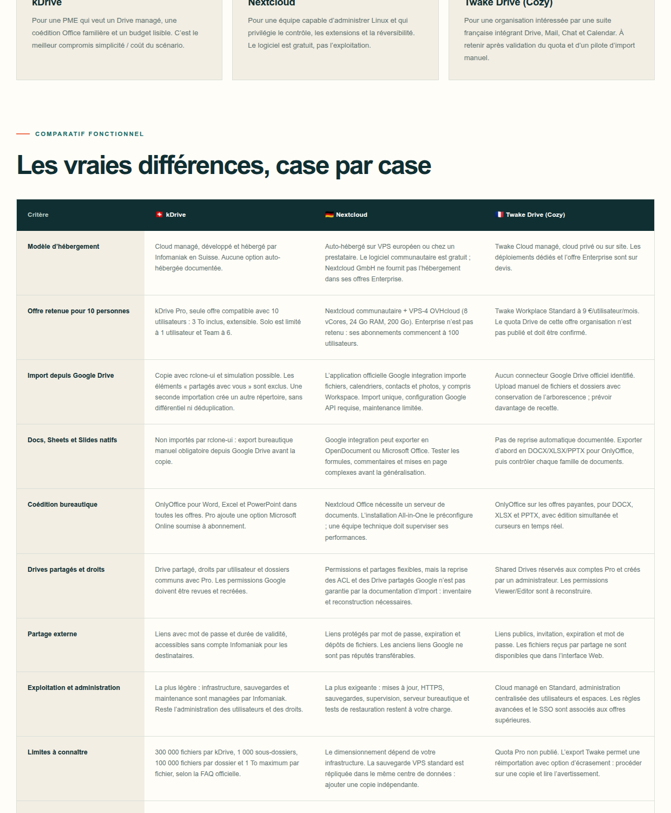
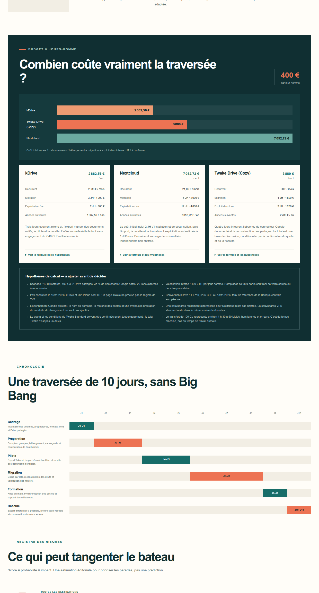
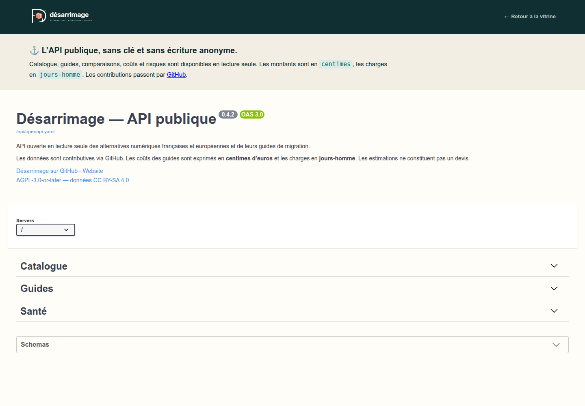

# Désarrimage 0.4.2 — La réponse à la grande question

**Et non, 42 ne remplace pas un bon plan de migration.** ⚓

Désarrimage passe un nouveau cap : vous ne savez plus seulement **quel outil choisir**, vous savez aussi **comment y aller, combien de temps prévoir, quel budget anticiper et quels risques surveiller**.

## Le cas concret : quitter Google Drive

Notre premier guide complet compare trois chemins pour une PME de **10 personnes et 100 Go de fichiers** :

- **Nextcloud**, pour garder le contrôle technique ;
- **kDrive**, pour choisir un cloud managé simple et lisible ;
- **Twake Drive (Cozy)**, pour rejoindre une suite collaborative française.

Vous obtenez un comparatif en 10 critères, un planning en 10 jours, 7 risques avec leurs parades et 19 sources officielles pour vérifier les informations vous-même.

**[Explorer le guide complet](https://desarrimage.prigent.tech/produit/google-drive)**

## Combien ça coûte ?

Nous avons fait les calculs sur une base de **400 € HT par jour-homme**, en séparant abonnement, migration et exploitation.

| Destination | Coût estimé année 1 | Ensuite |
|---|---:|---:|
| **kDrive Pro** | **2 862,56 €** | 1 662,56 €/an |
| **Twake Drive** | **3 880 €** | 2 280 €/an |
| **Nextcloud** | **7 052,72 €** | 5 052,72 €/an |

Le résultat est parlant : **le logiciel gratuit ne signifie pas une migration gratuite**, et l’auto-hébergement se paie surtout en temps d’administration.

Ces montants sont des estimations datées, pas un devis. Le quota et la fiscalité de Twake restent à confirmer, le taux CHF/EUR est sourcé auprès de la BCE et chaque hypothèse est visible dans la fiche.

## Une API ouverte, pour réutiliser les données

Catalogue, guides, comparaisons, coûts et risques sont accessibles **sans clé**, en lecture seule. Vous pouvez intégrer ces données dans votre propre outil, votre intranet ou votre cartographie de souveraineté.

**[Ouvrir le Swagger public](https://desarrimage.prigent.tech/swagger.html)**

Les contributions passent par GitHub : chaque cellule du comparatif peut être corrigée, sourcée et discutée séparément. Ouvert et dynamique, sans écriture anonyme.

## Et les petits détails qui comptent

- Drapeaux pour repérer immédiatement le pays des produits ;
- avantages **et** inconvénients affichés ;
- limites des outils d’import clairement expliquées ;
- coût des années suivantes, pas seulement celui de la première migration ;
- captures et notes techniques publiées pour garder une trace compréhensible de la release.

## Pourquoi cette version s’appelle 0.4.2 ?

Parce que **42 est la réponse à la grande question** dans *Le Guide du voyageur galactique* — et parce que nous préférons les projets qui ne se prennent pas trop au sérieux, tout en traitant les migrations très sérieusement.

La question, elle, reste simple :

> **Par quoi remplacer mes outils, et comment migrer sans perdre mes données ?**

Pour celle-ci, nous avons maintenant une première réponse documentée.

---

**[Voir le site](https://desarrimage.prigent.tech/) · [Lire la note technique](0.4.2-tech.md) · [Consulter le changelog](../../CHANGELOG.md)**
