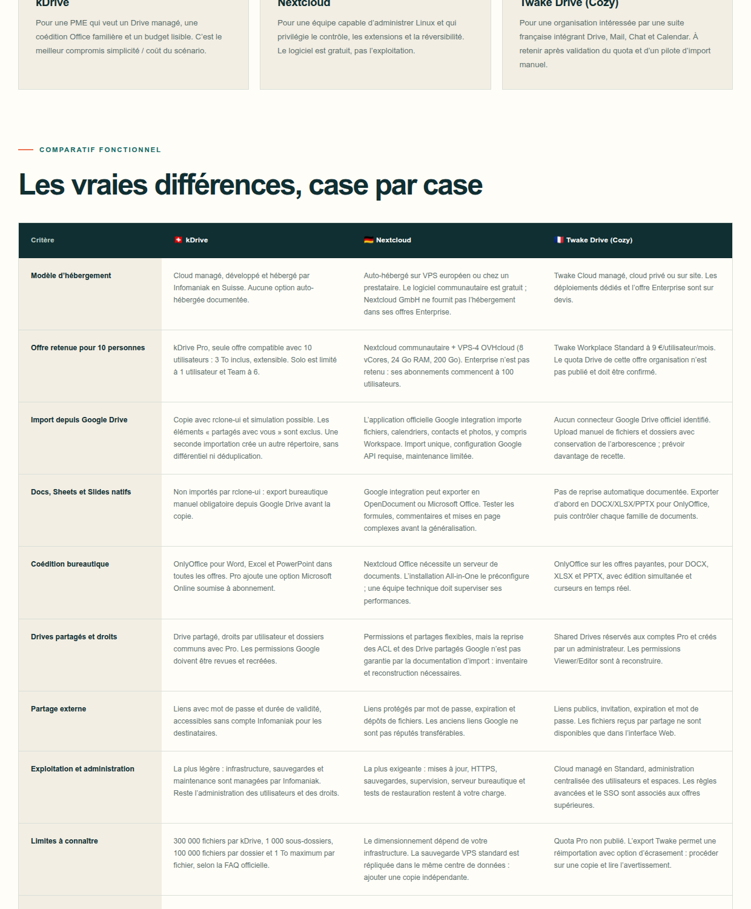
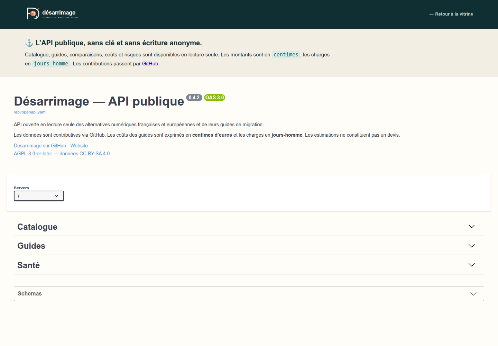

# Désarrimage 0.4.2 — Note technique

**Date :** 16 novembre 2026  
**Tag :** `v0.4.2`  
**Thème :** guides comparatifs normalisés, API publique et documentation OpenAPI.

## En bref

- Ajout d’un guide complet **Google Drive → Nextcloud, kDrive et Twake Drive (Cozy)**.
- Stockage relationnel des scénarios, critères, valeurs, coûts, risques, phases et sources.
- Import idempotent depuis `data/guides/*.json` avec `GuideSeeder`.
- Lecture publique avec `GuideRepository`, sans écriture anonyme.
- Documentation OpenAPI et Swagger UI auto-hébergés, sans CDN.
- Drapeaux de pays sur les produits et les comparaisons.
- Notes de version et captures publiées dans le dépôt.

## API publique

```text
GET /api/guides
GET /api/guides/{slug}
GET /api/guides/{slug}/comparison
GET /api/guides/{slug}/costs
GET /api/guides/{slug}/risks
GET /api/openapi.yaml
```

Interface : https://desarrimage.prigent.tech/swagger.html  
Exemple : https://desarrimage.prigent.tech/api/guides/quitter-google-drive

## Données et calculs

Le premier guide est versionné dans `data/guides/google-drive.json`. Chaque cellule du comparatif reste modifiable indépendamment en pull request.

Les montants sont stockés en **centimes d’euros**. Les charges sont exprimées en **jours-homme**. L’API calcule :

```text
coût migration = migration_days × day_rate_cents
coût exploitation annuelle = annual_operation_days × day_rate_cents
total année 1 = (mensualité × 12) + migration + exploitation
total années suivantes = (mensualité × 12) + exploitation
```

Scénario exposé : 10 utilisateurs, 100 Go, 2 Drive partagés, 35 % de documents natifs et 400 € HT/JH. Les hypothèses, sources et limites sont retournées par l’API. `verified_at` reste `null` : il s’agit d’un scénario éditorial, pas d’une migration métier prétendument effectuée.

## Base de données

La migration Phinx `20261116150000_create_migration_guides.php` ajoute les tables :

- `migration_guides` ;
- `guide_comparison_criteria` et `guide_comparison_values` ;
- `guide_costs` et `guide_assumptions` ;
- `guide_risks` et `guide_timeline` ;
- `guide_decisions` et `guide_sources`.

Le seed peuple actuellement **10 critères, 30 cellules, 3 coûts et 7 risques**, sans doublon lors des réimportations.

## Vérifications effectuées

- `make check` : Composer, syntaxe PHP, JSON, guides, SemVer et build Vite ;
- `make docker-check` : validation Compose ;
- démarrage réel de la stack Docker, migrations et seed ;
- appels API : catalogue, recherche, guide complet, sections et OpenAPI ;
- contrôle des totaux année 1 et années suivantes ;
- rendu desktop, mobile, Swagger et production Gandi.

## Captures

### Comparatif normalisé



### Swagger UI auto-hébergé



Les autres captures sont disponibles dans [`docs/images/`](../images/).
